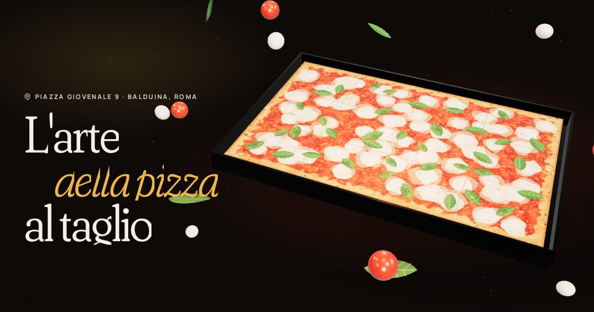

# Pizza ART — sito immersivo 3D

Sito one-page per **Pizza ART**, pizza al taglio storica di **Piazza Giovenale 9, Roma (Balduina)**.
Scroll 3D, animazioni interattive e contenuti modificabili da un solo file.



## Cosa c'è dentro

| Sezione | Cosa fa |
|---|---|
| **Preloader "lievitazione"** | La pasta lievita e il contatore arriva a 72 ore mentre la scena 3D si carica. |
| **Hero 3D (Three.js)** | Una teglia romana vera in 3D: si inclina col mouse, la luce segue il cursore, cliccando un trancio lo fai saltare. Scorrendo, la teglia si **scompone in 12 tranci** che volano nello spazio ("Tagliata al momento. Venduta a peso."). |
| **Marquee** | Nastro rosso inclinato che accelera e si deforma con la velocità dello scroll. |
| **Impasto 72h** | Sezione bloccata: scorrendo, il contatore va da 0 a 72 ore, le tappe si accendono e nell'immagine salgono le bolle di lievitazione. |
| **La galleria delle opere** | Scroll orizzontale in 3D (coverflow): ogni gusto è un'"opera" con cartellino da museo. Inclinazione e riflesso al passaggio del mouse, scheda di dettaglio al click. |
| **Friggitoria: "Tira il filo"** | Mini-gioco: trascini metà supplì, la mozzarella si allunga e prima o poi si spezza. Il record resta salvato. Funziona anche da tastiera. |
| **Componi la tua teglia** | Configuratore: scegli gli ingredienti, cadono sulla teglia uno per uno, l'opera prende un nome ("La Infernale", "La Boscaiola"…) e l'ordine parte **già scritto su WhatsApp**. |
| **Consegna a domicilio** | Mappa radar del quartiere con lo scooter che segue il percorso mentre scorri. |
| **Feste ed eventi** | Calcolatore "Quanti siete?" → quante teglie servono, con richiesta di preventivo su WhatsApp. |
| **Dal forno** | Carosello fotografico circolare in 3D, si gira con lo scroll o trascinandolo. |
| **Dove siamo** | Orari con il giorno di oggi evidenziato, stato **"Aperto ora / Chiuso"** calcolato sull'ora di Roma, mappa Google caricata solo dopo il consenso (GDPR). |
| **Footer** | La scritta gigante "Pizza ART" si riempie di rosso arrivando in fondo. |

Dettagli che fanno la differenza: cursore personalizzato, bottoni magnetici, rotella tagliapizza come barra di avanzamento, barra azioni fissa su mobile (Chiama · WhatsApp · Arrivare), scheda Google/SEO (`Restaurant` in JSON-LD), anteprima per i link condivisi (`og.jpg`), font ospitati in locale (niente Google Fonts, meglio per il GDPR), rispetto dell'impostazione "riduci movimento", versione statica se il dispositivo non supporta WebGL.

## Le foto (generate con AI)

Il locale non ha ancora foto, quindi sono state generate con l'AI di Canva e sono già nel tuo account Canva.
Finché non le aggiungi, il sito mostra **illustrazioni generate al volo** nello stesso stile (vedi l'anteprima), quindi è già presentabile.

| Nome file | Soggetto | Apri su Canva |
|---|---|---|
| `hero-teglia` | Teglia intera di margherita | [MAHWN4TsSPg](https://www.canva.com/M/MAHWN4TsSPg) |
| `pizza-bianca` | Pizza bianca con rosmarino | [MAHWNwCYwPE](https://www.canva.com/M/MAHWNwCYwPE) |
| `patate-rosmarino` | Trancio patate e rosmarino | [MAHWNyZSfd0](https://www.canva.com/M/MAHWNyZSfd0) |
| `diavola` | Trancio diavola | [MAHWN_dz0RQ](https://www.canva.com/M/MAHWN_dz0RQ) |
| `fiori-alici` | Trancio fiori di zucca e alici | [MAHWNyh49wg](https://www.canva.com/M/MAHWNyh49wg) |
| `mortadella-pistacchio` | Trancio mortadella, burrata, pistacchio | [MAHWNzrycmQ](https://www.canva.com/M/MAHWNzrycmQ) |
| `supli` | Supplì con il filo di mozzarella | [MAHWN5cDnxg](https://www.canva.com/M/MAHWN5cDnxg) |
| `fritti` | Cartoccio di fritti | [MAHWN82wQcU](https://www.canva.com/M/MAHWN82wQcU) |
| `impasto` | Mani che stendono l'impasto | [MAHWN1-E1as](https://www.canva.com/M/MAHWN1-E1as) |
| `consegna` | Scooter con i cartoni, Roma di sera | [MAHWNy9nc4E](https://www.canva.com/M/MAHWNy9nc4E) |
| `feste` | Tavola con tante teglie | [MAHWN7aG8LY](https://www.canva.com/M/MAHWN7aG8LY) |
| `forno` | Teglia che esce dal forno | [MAHWN6Mps1E](https://www.canva.com/M/MAHWN6Mps1E) |

Per metterle nel sito:

1. Scarica ogni immagine da Canva e salvala in `foto-originali/` con il nome della prima colonna (es. `supli.png`).
2. Esegui `npm run foto`: le ridimensiona, le converte in WebP e le mette in `src/assets/foto/`.
3. `npm run build`. Le foto vere prendono il posto delle illustrazioni, nessun'altra modifica.

In alternativa puoi caricarle direttamente in `src/assets/foto/` dal sito di GitHub ("Add file → Upload files"), con gli stessi nomi.
Nel footer c'è già la dicitura "Le immagini sono generate con intelligenza artificiale a scopo illustrativo": toglila quando arriveranno le foto vere del locale.

## Avvio

Serve Node.js 20 o successivo.

```bash
npm install
npm run dev      # anteprima locale su http://localhost:5173
npm run build    # sito pronto in dist/
npm run preview  # prova la build
npm run build:file  # UN SOLO file: dist-file/pizza-art.html (si apre con doppio clic)
```

`pizza-art.html` contiene tutto (codice, 3D, font, foto): si può mandare al cliente per email/WhatsApp o caricare da solo su qualsiasi hosting. Dopo aver aggiunto le foto, rilancia `npm run build:file` per rigenerarlo (con 12 foto pesa qualche MB in più).

## Modificare i contenuti

Tutto è in **`src/content.js`**: nome, indirizzo, telefoni, WhatsApp, orari, orari di consegna, gusti della galleria, fritti, ingredienti del configuratore, link a Maps e Facebook, Partita IVA, crediti dell'agenzia.
I testi delle sezioni sono in `index.html`.

### Da verificare con il titolare prima di pubblicare

- [ ] **Orari**: le fonti online dicono tutti i giorni fino alle 22:00, ma l'apertura è indicata sia alle 8:00 sia alle 8:30 (ora è 8:30).
- [ ] **WhatsApp**: il 346 183 0803 è attivo su WhatsApp? Se no, cambia `whatsapp` in `content.js`.
- [ ] **Gusti e fritti**: quelli in galleria sono i classici romani, da allineare al banco reale.
- [ ] **Durata della lievitazione**: il sito dice "fino a 72 ore" (dalle descrizioni online, 48–72 ore).
- [ ] **Partita IVA**: obbligatoria sul sito di un'attività, va in `vat`.
- [ ] **Zone di consegna** ed eventuale costo.
- [ ] **Logo ufficiale**, se esiste (ora c'è un marchio provvisorio: la teglia con un trancio sollevato).
- [ ] Dopo la pubblicazione, in `index.html` metti l'indirizzo completo in `og:image` (es. `https://www.pizzaartroma.it/og.jpg`) per l'anteprima nei link su WhatsApp.

## Pubblicazione

La build usa percorsi relativi, quindi `dist/` funziona su qualsiasi hosting statico.

- **Netlify**: trascina la cartella `dist/` su [app.netlify.com/drop](https://app.netlify.com/drop).
- **Vercel / Netlify da GitHub**: build command `npm run build`, cartella `dist`.
- **GitHub Pages**: il workflow `.github/workflows/deploy.yml` pubblica a ogni push su `main`. Va attivato una volta da Settings → Pages → Source: *GitHub Actions*.
- **Hosting tradizionale (Aruba, SiteGround…)**: carica via FTP il contenuto di `dist/`.

## Struttura

```
index.html                 markup di tutte le sezioni + SEO
src/content.js             dati del locale (da qui si modifica quasi tutto)
src/main.js                avvio: scroll fluido, preloader, timeline dell'hero
src/modules/hero3d.js      scena Three.js della teglia
src/modules/builder.js     configuratore "Componi la tua teglia"
src/modules/supli.js       mini-gioco "Tira il filo"
src/modules/sections.js    impasto, galleria, consegna, feste, carosello, mappa
src/modules/ui.js          header, menu, cursore, marquee, titoli animati
src/modules/business.js    orari, "aperto ora", collegamento dei contatti
src/lib/pizza-art.js       generatore procedurale di pizza (texture 3D e illustrazioni)
src/media.js               usa la foto se c'è, altrimenti l'illustrazione
scripts/importa-foto.mjs   ottimizzazione delle foto
```

Tecnologie: [Vite](https://vite.dev), [Three.js](https://threejs.org), [GSAP](https://gsap.com) (ScrollTrigger, SplitText), [Lenis](https://lenis.darkroom.engineering).
