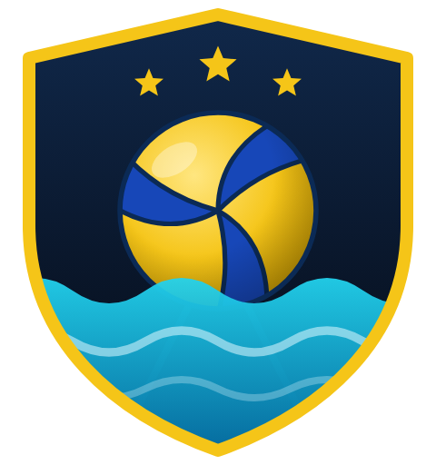

# Water Polo Manager — The Road to Glory



Gestionale di pallanuoto giocabile nel browser. Sei il presidente di una piccola società in **Serie C** e devi costruire una dinastia: promozioni, coppe nazionali, coppe europee. Tutto in italiano.

## Cosa c'è nel gioco

- **Creazione della società**: nome, abbreviazione, città, colori, stemma (forma, motivo, simbolo), piscina, anno di fondazione, tifosi, obiettivo e difficoltà (Facile, Normale, Difficile, Leggenda). La rosa iniziale è davvero debole (overall 25-50, nessun campione nascosto).
- **Società reali**: tutte le squadre sono club veri. Serie A1 (14, da Pro Recco a Roma Vis Nova), Serie A2 (girone Nord e Sud da 12), Serie B (4 gironi da 10) e Serie C (4 gironi geografici da 10, la tua società compresa), più 50 club europei reali per le coppe di European Aquatics (Ferencváros, Barceloneta, Olympiacos, Radnički, Novi Beograd, Marseille, Mladost…). Gli elenchi sono in `src/engine/data/realClubs.ts`: la composizione di A1/A2 segue la stagione 2025/26, quella di B e C è indicativa e si modifica lì. I giocatori, gli allenatori e gli stemmi sono invece inventati.
- **Giocatori reali**: 36 società (tutte le 14 di Serie A1, 8 di A2, 2 di B e 12 club europei) schierano i loro giocatori veri, con nome, nazionalità, ruolo, numero di calottina e, dove disponibile, anno di nascita, ricavati dalla sezione "Rosa" più recente delle loro voci su Wikipedia (`src/engine/data/realPlayers.ts`, con la fonte di ogni rosa). Le caratteristiche tecniche sono stimate dal gioco: chi ha una propria voce enciclopedica (nazionali, olimpionici) parte più forte. Per le società senza una rosa pubblica (quasi tutta la B e la C) e per il tuo club appena fondato i giocatori sono generati.
- **Rose da 15 in ogni categoria**, senza limite di stranieri: ogni squadra, dalla A1 alla C, tessera esattamente 15 giocatori (2 portieri, 2 centroboa, 2 difensori, 2 centrovasca, 2 mancini, 3 ali, 2 universali). Le società AI restano sempre a quota 15; tu non puoi superare il limite e prima di ogni partita ufficiale la lista deve essere in regola (con il pulsante «Completa la rosa» per i casi urgenti). Il limite è una regola del mondo (`rosterSize`), modificabile.
- **Ruoli della pallanuoto**: portiere, centroboa (BOA), difensore/marcatore del centroboa (DIF), centrovasca (CV), mancino (MAN, sempre di sinistro), ala, universale. In acqua si gioca con le posizioni numerate 1-6 (1 ala destra, 2 lato destro, 3 centrovasca, 4 lato sinistro, 5 ala sinistra, 6 centroboa); i mancini rendono meglio a destra e in difesa il centroboa avversario è marcato da chi ha le migliori doti difensive.
- **Regolamenti configurabili** (salvati nella carriera, non cablati nel codice): gironi, punti, promozioni e retrocessioni dirette, playoff scudetto, playoff promozione, playout, Coppa Italia con teste di serie, Supercoppa, European Aquatics Champions League, Euro Cup, Conference Cup e Super Cup, finestre di mercato, licenza nazionale.
- **Motore partita** possesso per possesso, deterministico (seed salvato): sprint, contropiedi, palle perse, espulsioni temporanee, superiorità e inferiorità numerica, rigori, tre falli gravi, brutalità, infortuni, fatica, cambi, time-out, rigori finali e confronti andata/ritorno. Le probabilità dipendono da caratteristiche dei giocatori in acqua, posizione e mano preferita, energia, morale, forma, affiatamento, allenatore, tattiche e familiarità con esse, fattore campo e importanza della partita.
- **Minutaggio dei panchinari**: dalla Formazione scegli quanti minuti deve giocare ogni riserva (o lasci il consigliato, basato su quanto si aspetta il giocatore). L'allenatore li fa entrare e uscire a gioco fermo anche quando simuli la partita; chi gioca molto meno di quanto si aspetta si scontenta.
- **Risultati realistici**: come nella pallanuoto vera la qualità decide quasi sempre. Con grandi differenze di forza il favorito vince quasi sempre (le prime di un girone con le ultime: oltre il 95%), mentre tra squadre vicine in classifica l'esito è aperto e la più debole può spuntarla (a 2-4 punti di forza di distanza vince circa una volta su tre). Il peso della qualità è regolato da `SKILL_LINEAR`, `SKILL_CONVEX` e `DAY_FORM_SD` (forma del giorno) in `src/engine/match/engine.ts`; la forza delle società è distribuita in modo che ogni girone abbia squadre forti, medie e deboli.
- **Carriere già salvate**: all'apertura vengono aggiornate da sole (versione 4): le società inventate prendono l'identità di società reali della stessa categoria, quelle con una rosa pubblica schierano i giocatori veri (con la forza di squadra di prima; gli inventati sostituiti si ritirano), le forze di A2, B e C vengono rimescolate e allargate per avere gironi con squadre forti e deboli; la tua squadra e i tuoi giocatori restano come sono; le regole su risultati, infortuni, eventi e stranieri valgono subito perché sono nel motore di gioco.
- **Eventi imprevisti rari**: i guasti alla piscina e il caro energia sono rari (ogni diversi anni, quasi mai con impianti recenti) e non si susseguono; i guasti sono di tipo diverso (pompa, filtri, perdite, riscaldamento).
- **Cronaca**: risultato immediato, simulazione veloce o cronaca interattiva con cambi, tattiche e time-out durante la gara; tabellino con voti, migliore in acqua e statistiche complete.
- **Tattiche**: 8 sistemi offensivi e 7 difensivi con vantaggi e svantaggi reali, superiorità (4-2/3-3, circolazione, strategia, tiratori designati) e inferiorità (stili, marcatura speciale). Le tattiche avanzate si sbloccano con la capacità organizzativa (allenatore, vice, centro di allenamento, intelligenza tattica della rosa, esperienza della società) e vanno imparate (familiarità).
- **Giocatori**: 31 caratteristiche (tecniche, fisiche, mentali, da portiere), overall pesato per ruolo, potenziale stimato dagli osservatori, personalità, crescita e declino con l'età, allenamento individuale, infortuni rari e per lo più brevi (come nella pallanuoto vera), recupero fisico rapido, squalifiche, morale, richieste di minutaggio, promesse.
- **Mercato**: ricerca, osservati, osservatori in missione, offerte e controfferte, trattative a più giri (richiesta che scende verso un minimo, pazienza limitata, offerte offensive che irritano il giocatore o il club e possono chiudere la trattativa), prestiti, svincoli, rinnovi, offerte dei club AI per i tuoi giocatori. I giocatori da categoria superiore scendono malvolentieri.
- **Economia**: sponsor con obiettivi, bonus e malus; biglietti e abbonamenti con prezzi regolabili; merchandising; scuola nuoto; contributi; premi; stipendi settimanali, staff, piscina, trasferte, manutenzione, interessi; fido bancario, prestiti, investimenti del presidente; stipendi arretrati, penalizzazioni, giocatori in mora e fallimento.
- **Strutture** (7, livelli 1-5) con effetti concreti e **livello di sviluppo della società** che sblocca i livelli più alti.
- **Settore giovanile** con ingresso annuale di ragazzi: qualità legata al vivaio e al responsabile; raramente nasce un fuoriclasse.
- **AI delle società**: mercato, rinnovi entro budget, esoneri e nuovi allenatori, staff, strutture, mecenati e crisi societarie, scelte tattiche in base a rosa e avversario.
- **Eventi e decisioni presidenziali** con conseguenze reali (il miglior giocatore vuole andarsene, sponsor che si ritira, allenatore sotto pressione, offerta di acquisizione, guasti alla piscina, contestazioni, stipendi arretrati, tornei estivi…).
- **Ciclo stagionale**: mercato estivo, precampionato, campionato, mercato invernale, playoff e playout, verdetti, premi, invecchiamento, ritiri, nuova stagione. Storia del club, albo d'oro, leggende.
- **Illustrazioni 2D** generate con l'AI di Canva in uno stile unico (menu, dashboard, strutture, mercato, staff, vivaio, partite, coppe, fine stagione): `src/assets/art/`.
- **Più intuitivo**: navigazione raggruppata (Squadra, Gare, Società), pannello "Da fare adesso" con le prossime mosse utili, guida rapida al primo avvio (riapribile con "?"), spiegazioni contestuali.
- **Identità visiva**: logo del gioco (scudo con pallone giallo-blu che emerge dall'acqua e le tre stelle della "road to glory"), favicon e kit grafico in [`brand/`](brand/BRAND.md); ogni società ha stemma generato nei suoi colori e le tre calottine regolamentari (scura, chiara, rossa del portiere).
- **Account e cloud** (facoltativi): con email e password le carriere si salvano anche online (funzione Netlify `netlify/functions/pallanuoto.mts`, Netlify Blobs) e si riprendono da un altro computer o dal telefono. Se la stessa carriera viene giocata su due dispositivi, il gioco lo rileva e fa scegliere quale versione tenere. Password con PBKDF2, blocco dopo 5 tentativi sbagliati, nessuna email inviata, account eliminabile con tutti i dati. Prova di integrazione: `npm run test:pallanuoto` (dalla radice del repository).
- **Salvataggi** automatici in IndexedDB: più carriere, carica, rinomina, elimina, esporta/importa su file. Il gioco riparte da dove l'avevi lasciato anche dopo la chiusura del browser.

## Architettura

```
src/engine/            logica di gioco, senza React (testabile in Node)
  types.ts             tipi del dominio (tutto serializzabile)
  rng.ts               generatore deterministico con stato salvato
  data/                nomi, città, regolamenti e difficoltà
  player/              caratteristiche, overall, generazione, sviluppo, valore
  club/                società, formazioni, strutture, gestione
  staff/ tactics/      allenatori, staff, tattiche e capacità organizzativa
  match/               motore partita, cronaca, setup e applicazione dei risultati
  competition/         calendari, classifiche, eliminazione diretta, postseason
  economy/ transfer/   finanze, sponsor, contratti, mercato
  ai/ events/          AI delle società, eventi casuali
  season/              ciclo giornaliero/settimanale, fine e inizio stagione
  world/               generazione del mondo e interrogazioni
src/store/game.ts      stato dell'app (zustand) e salvataggio automatico
src/db/saves.ts        persistenza IndexedDB
src/ui/                interfaccia React + Tailwind
src/test/              test del motore e simulazioni multi-stagione
```

## Sviluppo

```sh
npm install
npm run dev          # http://localhost:5173
npm test             # test del motore (calibrazione, tattiche, 5 stagioni complete)
npm run build        # build in dist/
npm run build:site   # build in ../public/pallanuoto (pubblicata dal sito Netlify)
npm run brand        # rigenera favicon e loghi SVG da src/ui/brand.ts
```

Requisiti: Node 20+.

### Contratti e trattative
- Il rinnovo segue il valore *attuale* del giocatore: chi è migliorato chiede di più, chi è calato, invecchiato o è pagato sopra il suo valore accetta uno stipendio più basso. Anche morale e lealtà contano.
- Ogni trattativa (giocatore o club venditore) ha richiesta iniziale, minimo e pazienza (numero di giri). A ogni giro la richiesta scende; la controproposta si può accettare con un click.
- Vale anche per le carriere già avviate: la logica è del motore, non serve migrare i salvataggi.

### Promozioni e playoff
- **A1**: playoff scudetto tra le prime 8, playout 12ª-13ª, ultima retrocessa. **A2**: playoff promozione tra le prime 4 di ogni girone (1 promossa per girone).
- **Serie B**: non sale più solo la prima: le prime 4 di ogni girone giocano i playoff (semifinali 1ª-4ª e 2ª-3ª, finale, al meglio delle 3); la vincente di ogni girone è promossa in A2. Le ultime 2 di ogni girone retrocedono.
- **Serie C**: la prima sale direttamente, le classificate 2ª-5ª giocano i playoff per un secondo posto in B.
- Le carriere già avviate vengono aggiornate dalla migrazione v5 (le regole sono salvate nel mondo).

### Piramide dei livelli
- Ogni categoria ha una fascia di forza di squadra (A1 60-78, A2 47-62, B 34-50, C 24-44) e ogni giocatore di una società resta in una finestra attorno al livello della sua squadra (da -8 a +7). Così un titolare dell'ultima di A1 vale più del miglior giocatore di B, ruolo per ruolo (anche i centroboa).
- Il bilanciamento (`src/engine/world/pyramid.ts`) gira alla creazione del mondo, a ogni inizio stagione dopo promozioni e retrocessioni e, una volta, sulle carriere esistenti (migrazione v6). La tua società e i tuoi giocatori non vengono toccati.

### Punteggi
- L'effetto della qualità sul risultato ha un tetto: con un divario moderato (10 punti) la favorita segna circa 15-10, con un divario grande circa 18-7, e solo con divari enormi si arriva a 20-5. Prima della correzione bastavano 10 punti di differenza per 19-8 e i divari enormi davano punteggi assurdi (fino a 50-0).
- Le vittorie della favorita restano molto probabili (circa 82% con 10 punti di differenza, 99% con 20), ma gli scarti sono quelli di una partita di pallanuoto vera. Regolazione in `SKILL_LINEAR`, `SKILL_CONVEX`, `SKILL_CAP` e `DAY_FORM_SD` di `src/engine/match/engine.ts`.
- Con un largo vantaggio (da 6 gol in su) chi è in testa gestisce la partita: segna meno e perde più palloni. Così gli scarti enormi (tipo 26-0) non succedono più, mentre la favorita vince comunque quasi sempre.

### Coppe europee (European Aquatics, ex LEN)
- **Champions League**: 16 club in 4 gironi da 4 (andata e ritorno, da metà ottobre a dicembre); le prime 2 di ogni girone vanno ai "quarti di finale", due gironi da 4 (marzo-maggio); le prime 2 di ciascuno giocano la **Final Four** (semifinali l'11 giugno e finale il 13 giugno). Le ultime 2 dei gironi iniziali scendono agli ottavi di Euro Cup. Posti: Italia 1ª e 2ª di A1, Ungheria, Serbia, Spagna, Grecia e Croazia 2 club a testa, Francia, Germania, Montenegro e Romania 1.
- **Euro Cup** (l'"Europa League" della pallanuoto): 16 club in 4 gironi da 4, le prime 2 passano al tabellone dove trovano le 8 retrocesse dalla Champions League: ottavi, quarti, semifinali e finale in andata e ritorno. Italia: 3ª e 4ª di A1.
- **Conference Cup** (la terza coppa, nata nel 2025/26 al posto della Challenger Cup): ottavi in andata e ritorno, quarti, Final Four e finale su campo neutro. Italia: 5ª e 6ª di A1.
- **Super Cup**: la vincitrice della Champions League contro la vincitrice della Euro Cup, gara secca a inizio ottobre. Alla prima stagione si parte dai vincitori reali 2025/26 (Atlètic-Barceloneta e Marseille).
- I club esteri hanno una classifica nazionale simulata in base alla forza; i grandi club (Barceloneta, Ferencváros, Olympiacos, Radnički, Novi Beograd, Jadran Split, Mladost, Marseille) partono più forti. Le rose contengono i nazionali veri degli Europei 2026 (società e ruoli del 9 gennaio 2026); i posti restanti li completa il gioco con giocatori generati, le cui caratteristiche NON sono reali.
- Semplificazioni: i turni di qualificazione (settembre/ottobre) non ci sono, si parte dalle fasi principali con i club ammessi in base alla forza; non c'è la finale per il terzo posto della Final Four.
- Le carriere esistenti vengono aggiornate dalla migrazione v7 (regole, club europei mancanti, rose vere). La stagione europea già in corso termina con la formula vecchia: la nuova parte dalla prossima.

### Niente inflazione
- Mercato, sviluppo e stipendi facevano salire piano piano il livello dei club del computer: in 12 stagioni la forza media della A2 passava da 55 a 61 e quella della B da 43 a 49, così chi giocava da anni trovava avversari sempre più forti senza colpa sua.
- Ora a ogni inizio stagione la forza media di ogni categoria (A1 70, A2 55, B 43, C 35) torna a quella di partenza spostando in blocco la forza dei club del computer: le differenze tra i club restano, il livello complessivo no. La tua società non viene mai toccata. Sulle carriere esistenti lo fa la migrazione v8 (fino a 8 punti in una volta).

### Overall precisi e giocatori famosi
- Ogni giocatore vero ha un overall **preciso**, non un intervallo: i fuoriclasse sono in `src/engine/data/playerRatings.ts` (Alvaro Granados 97, Argyropoulos e Skoumpakis 96, Mandić 95, Manhercz 94, Kakaris e Glušac 93…), con un giudizio basato su premi e risultati recenti (MVP dei Mondiali 2025, giocatore dell'anno 2025 e 2026, squadra ideale degli Europei 2026). Hanno lo stesso valore in ogni carriera e il bilanciamento dei livelli non li tocca.
- Chi non è in elenco ha un overall calcolato dal livello del club, dall'esperienza internazionale, dall'età e da una piccola differenza fissa derivata dal nome: stesso risultato in ogni carriera. I club di vertice (Recco, Ferencváros, Barceloneta, Olympiacos, Brescia, Radnički, Novi Beograd, Mladost…) hanno rose molto più forti: `TOP_CLUB_LEVELS`. I loro giocatori veri sono fissi.
- Il campionato italiano di A1 va da 60 a 88 di forza di squadra (l'ultima contro la prima è un abisso, come nella realtà).
- Le carriere esistenti vengono aggiornate dalla migrazione v9 (valori precisi dei campioni e club di vertice rinforzati).

### Allenamento
- La crescita dei giocatori con l'allenamento è molto più forte (`TRAINING_BOOST`): strutture, preparatore, intensità alta (+30%) e minutaggio pesano di più, e un buon preparatore atletico rallenta davvero il declino dei veterani.
- **Allenamento mirato**: dalla scheda del giocatore si scelgono fino a 3 caratteristiche (per esempio Tiro o Marcatura) che crescono 2,6 volte più in fretta e, per i veterani, calano molto più piano. Le caratteristiche segnate con ★ sono quelle che pesano di più sull'overall del ruolo.
- **Età dei giocatori veri**: 224 giocatori su 629 hanno l'anno di nascita reale (rose pubbliche ed elenchi degli Europei 2026); per gli altri l'età è fissa (22-31 anni, calcolata dal nome). Chi ha più di 44 anni (rose non aggiornate) non entra in rosa; oltre i 34 anni l'overall cala di 1,3 punti per anno (anche per i campioni in elenco), quindi un veterano di 40 anni non è più un fuoriclasse.

### Niente squalifiche, infortuni rari
- Le squalifiche non esistono più (in pallanuoto capitano al massimo una volta l'anno): niente cartellini rossi per brutalità, niente giocatori che saltano partite per squalifica, niente badge né avvisi in formazione. L'espulsione definitiva dopo 3 falli vale solo per quella partita. Le carriere esistenti le cancellano con la migrazione v10.
- Gli infortuni sono ancora più rari: in partita circa 1 ogni 77 gare (prima 1 ogni 33), in allenamento un terzo di prima, e durano il 20% in meno. Strutture mediche e preparatore atletico li riducono ancora.

### Cloud: niente più domande ogni 20 secondi
- Il salvataggio nel cloud parte ogni 20 secondi. Se un caricamento era ancora in corso (salvataggio grosso o connessione lenta) ne partiva un secondo con la versione "vecchia" come base, e il server lo scambiava per un altro dispositivo: usciva la finestra del conflitto a ogni giro. Ora un solo caricamento alla volta (il successivo parte quando il primo finisce) e un "conflitto" causato da una versione caricata da questo stesso dispositivo viene risolto senza chiedere nulla.
- Se l'altro dispositivo ha davvero salvato (e magari è spento), nella finestra c'è la scelta **"Decido dopo"**: continui a giocare qui, il cloud va in pausa e non ti viene più chiesto finché non riapri la carriera.

### Mercato più ricco
- **Tutti i giocatori del mondo sono visibili** nel Mercato, anche quelli dei club esteri (è lì che stanno molti campioni). Prima, con il centro scouting sotto il livello 3, i giocatori stranieri erano nascosti e sembrava che il migliore comprabile fosse un 84. Ora gli stranieri meno noti hanno solo una stima approssimativa dell'overall; i fuoriclasse (88+ o in elenco) li conoscono tutti.
- **Ricambio dei campioni**: ogni stagione il mondo mantiene un numero minimo di giocatori forti (almeno 5 sopra 93, 10 sopra 91, 20 sopra 89, 36 sopra 87, 70 sopra 84, 130 sopra 80): i migliori giovani e giocatori nel pieno della carriera salgono di qualche punto fino a riempire la scala. Senza ricambio i campioni invecchiavano e dopo qualche anno il massimo era 84.
- **Svincolati di livello**: ogni estate ci sono almeno 12 svincolati sopra 72, 4 sopra 80 e 1 sopra 86 (si pagano con l'ingaggio, non con il cartellino). I buoni giocatori senza squadra non "spariscono" più: restano sul mercato fino a 41 anni e non vengono tolti per fare spazio.
- Le carriere esistenti ricevono tutto con la migrazione v11.

### Offerte di mercato
- **Bug corretto**: nella finestra dell'offerta gli errori (liquidità insufficiente, mercato chiuso, giocatore non interessato, "categoria superiore") non comparivano più dopo il rifacimento a più giri, quindi "Invia offerta" sembrava non fare nulla. Ora compaiono in un riquadro rosso, e la cifra proposta non supera la liquidità.
- La **rosa piena (15) non blocca più le offerte né le trattative** con i giocatori: si tratta normalmente e, quando c'è l'accordo, il gioco chiede chi svincolare (con il costo della buonuscita) e firma. Prima il pulsante era disattivato e per fare un'offerta bisognava prima liberare un posto.
- A mercato chiuso la finestra dice quando riapre; gli svincolati si ingaggiano sempre.

### Allenamento e declino (corretto)
- **Perché i giocatori calavano anche con i bonus**: la curva d'età partiva dai 29 anni con perdite ripide (da -0,6 a -3,9 punti l'anno) e i bonus di allenamento (strutture, intensità) incidevano pochissimo sul calo; inoltre chi era già al proprio potenziale non migliorava più, qualunque fosse l'allenamento.
- Ora la curva è più dolce (picco fino a 28 anni, poi -0,25 a 29, -0,5 a 30, -0,85 a 31, -1,3 a 32, -1,9 a 33…) e il calo è frenato da palestra, centro di allenamento, preparatore atletico e intensità alta: con tutto al massimo un veterano perde circa un terzo di prima (a 31 anni circa zero, a 33 circa -1).
- Chi è al potenziale e ha meno di 32 anni continua a guadagnare un po' con strutture al massimo (circa +1 l'anno) e con l'allenamento mirato; il potenziale sale insieme all'overall.
