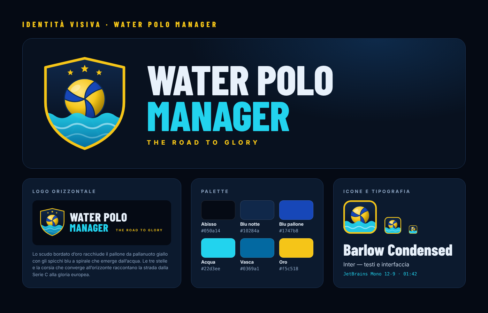

# Water Polo Manager — The Road to Glory · Identità visiva

## Il marchio

Uno **scudo blu notte bordato d'oro** racchiude un **pallone da pallanuoto giallo con gli spicchi blu a spirale**
che emerge dall'acqua. Le **tre stelle** in alto e la **corsia** che converge all'orizzonte raccontano il percorso
del presidente: dalla Serie C alla gloria europea.

| File | Uso |
| --- | --- |
| `logo-mark.svg` / `logo-mark-512.png` | Stemma da solo (avatar, splash, social) |
| `logo-horizontal.svg` | Stemma + scritta (intestazioni, documenti) |
| `app-icon.svg` / `app-icon-512.png` | Icona dell'app, favicon (`public/favicon.svg`) e `public/apple-touch-icon.png` |
| `brand-sheet.png` | Tavola riassuntiva |

Il marchio è generato da codice in [`src/ui/brand.ts`](../src/ui/brand.ts): l'app (componenti `Logo` e `LogoMark`),
la favicon e i file SVG di questa cartella sono sempre identici. Dopo una modifica: `npm run brand`.

## Colori

| Nome | Esadecimale | Ruolo |
| --- | --- | --- |
| Abisso | `#050a14` | Sfondo principale |
| Blu notte | `#10284a` | Pannelli, interno dello scudo |
| Navy | `#0b2a55` | Solchi del pallone, testi su oro |
| Blu pallone | `#1747b8` | Spicchi del pallone |
| Acqua | `#22d3ee` | Accento principale, "MANAGER", azioni |
| Vasca | `#0369a1` | Profondità dell'acqua |
| Oro | `#f5c518` | Bordo dello scudo, stelle, tagline, trofei |

## Tipografia

- **Barlow Condensed** (700-800): titoli e scritta del logo, sempre in maiuscolo.
- **Inter**: testi e interfaccia.
- **JetBrains Mono**: numeri, punteggi, cifre economiche.

## Identità delle società

Ogni società ha uno **stemma generato** (forma, motivo e simbolo scelti in base al nome: onde per i circoli
canottieri e nautici, delfino per le Rari Nantes, corona per le società della Capitale, iniziali per i CUS) nei
suoi **colori sociali**, e le **tre calottine** previste dal regolamento: scura, chiara e rossa del portiere
(componente `Cap` / `ClubCaps`). Le trovi nella pagina di ogni società e nella creazione del club.

## Regole d'uso

- Su sfondi chiari usare lo stemma completo (ha già il suo fondo blu): non ricolorarlo.
- Spazio di rispetto attorno allo stemma: almeno 1/4 della sua larghezza.
- Dimensione minima: 24 px per l'icona, 28 px per lo stemma.
